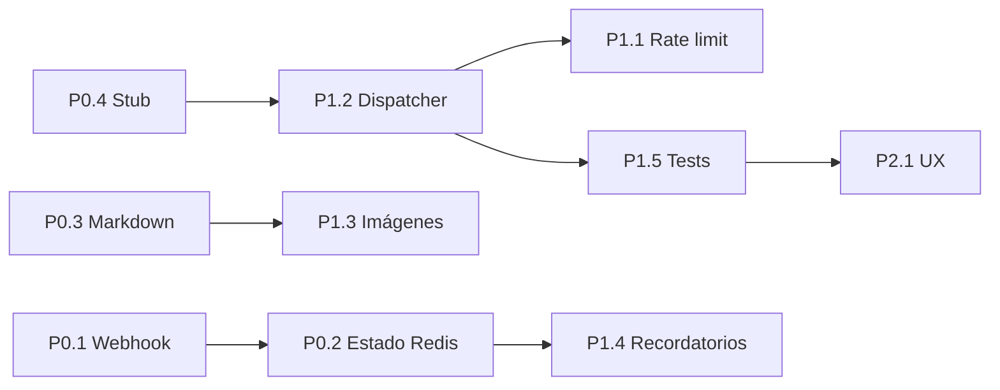

# 🤖 Agents.md — Plan de Mejora del Bot de Telegram

> **Documento de orquestación** para las mejoras del Bot de Telegram de *Medical Appointments API*.
> Define roles de agentes, backlog priorizado, dependencias, convenciones y métricas de éxito.
> Actualizar este archivo a medida que se completan tareas (marcar `[x]`).

---

## 1. Visión

Convertir el Bot de Telegram en un **asistente médico omnicanal, escalable y seguro**, capaz de:
- Atender consultas médicas (texto + imagen) con IA (Gemini).
- Gestionar citas, historial clínico, recetas y recordatorios.
- Operar en producción con webhooks, estado persistente y observabilidad.
- Mantener alta calidad (tests, lint, CI) y UX consistente.

---

## 2. Principios de orquestación

- **Un agente = un scope acotado** (ver §3). Cada agente entrega artefactos (código + tests + docs) y no toca código fuera de su scope sin PR de revisión.
- **Backlog priorizado** (P0 → P1 → P2). No iniciar P1 hasta que P0 esté verde en CI.
- **Definition of Done (DoD)** (ver §7) para cada tarea.
- **Branching**: `feat/bot-<area>-<slug>` → PR → revisión → merge a `main`.
- **Commits**: Conventional Commits (`feat`, `fix`, `refactor`, `test`, `docs`, `chore`).
- **Fuente de verdad**: este `Agents.md` + `README.md` + `ET.md`.

---

## 3. Roles de agentes (orquestación)

| Agente | Scope (archivos) | Responsabilidad |
|--------|------------------|-----------------|
| **A1 — Bot Core** | `src/telegram/services/telegram*.service.ts`, `telegram.module.ts`, controllers | Comandos, menús, dispatcher, UX, i18n |
| **A2 — IA & Gemini** | `src/Gemini/gemini.service.ts`, `telegram-ai.service.ts`, `telegram-lab-results.service.ts` | Prompts, sanitizado, multimodal, límites |
| **A3 — Persistencia & Estado** | `USER_STATES_MAP`, Redis, entidades, repositorios | Sesiones, FSM, idempotencia de recordatorios |
| **A4 — Transporte & Infra** | `telegramWebhook.controller.ts`, Docker, CI | Webhook, polling, secret token, deploy |
| **A5 — Seguridad** | guards, validación, rate limiting | Anti-abuso, CORS, firmas, secretos |
| **A6 — Calidad & Tests** | `test/`, `*.spec.ts` | Unit/E2E, cobertura > 90% en módulos críticos |
---

## 4. Backlog priorizado

### P0 — Crítico (producción)

- [ ] **P0.1** Migrar de polling a webhooks con `secret_token` y verificación de firma.
  - Agente: A4 · Archivos: `telegramWebhook.controller.ts`, `telegram.module.ts`
  - DoD: webhook activo en staging, firma verificada, tests E2E de recepción.

- [ ] **P0.2** Persistir estado de conversación en Redis (reemplazar `USER_STATES_MAP` en memoria).
  - Agente: A3 · Archivos: `telegram.module.ts`, servicios que usan `userStates`
  - DoD: estado sobrevive restart; multi-instancia OK; tests de recuperación.

- [x] **P0.3** Corregir escapado de Markdown en respuestas de Gemini.
  - Agente: A2 · Archivos: `gemini.service.ts` (`sanitizeMarkdown`), `telegram-ai.service.ts`
  - DoD: respuestas legibles con formato; disclaimer correcto; tests de sanitizado.

- [x] **P0.4** Eliminar stub `TelegramService.sendMessage` (implementar o remover).
  - Agente: A1 · Archivos: `telegram.service.ts`
  - DoD: sin métodos no implementados; lint verde.

### P1 — Alto (escalabilidad y calidad)

- [ ] **P1.1** Rate limiting por `chatId` (comandos e IA). (A5)
- [ ] **P1.2** Refactor del dispatcher de comandos (extraer router, reducir god class). (A1)
- [ ] **P1.3** Validación y compresión de imágenes antes de Gemini. (A2)
- [ ] **P1.4** Idempotencia y retry en recordatorios. (A3)
- [ ] **P1.5** Tests unitarios + E2E del módulo Telegram. (A6)
### P2 — Medio (UX y observabilidad)

- [ ] **P2.1** Menú de comandos (`setMyCommands`) + botones inline con paginación. (A1)
- [ ] **P2.2** Deep links `/start <payload>` para vincular cuentas web↔Telegram. (A1)
- [ ] **P2.3** Confirmaciones para acciones destructivas. (A1)
- [ ] **P2.4** Logging estructurado + métricas (mensajes, latencia Gemini, errores). (A7)
- [ ] **P2.5** i18n (es/en) con claves de traducción. (A1)
- [ ] **P2.6** Typing indicator prolongado durante llamadas a Gemini. (A2)

---

## 5. Dependencias y orden de ejecución

**Regla**: P0 completo antes de iniciar P1; P1 completo antes de P2.

---

## 6. Convenciones específicas del bot

- **Comandos**: regex en `onText` con prefijo `/`, documentados en `setMyCommands`.
- **Estado**: usar claves tipadas (`enum BotState`) en lugar de `any`.
- **Mensajes**: máximo 4096 chars; chunking obligatorio para IA.
- **Errores**: siempre capturar y responder al usuario con mensaje amigable + log estructurado.
- **Secretos**: nunca loguear tokens; usar `ConfigService`.
- **IA**: incluir disclaimer médico en toda respuesta generada.
---

## 7. Definition of Done (DoD)

Para cada tarea del backlog:
1. Código compila (`npm run build`).
2. Lint y format pasan (`npm run lint`, `npm run format`).
3. Tests unitarios nuevos/actualizados y verdes (`npm test`).
4. Cobertura no disminuye en módulos tocados.
5. Documentación actualizada (README/Agents.md) si aplica.
6. PR con descripción, screenshots/logs y checklist.
7. Revisión por al menos 1 mantenedor.
8. Merge a `main` con CI verde.

---

## 8. Métricas de éxito

| Métrica | Baseline | Objetivo |
|---------|----------|----------|
| Tiempo de respuesta IA (p95) | — | < 4 s |
| Tasa de error en comandos | — | < 1 % |
| Cobertura `telegram/` | ~0 % | > 90 % |
| Mensajes perdidos en restart | N/A (in-memory) | 0 (Redis) |
| Latencia webhook (p95) | — | < 500 ms |

---

## 9. Riesgos y mitigaciones

| Riesgo | Mitigación |
|--------|------------|
| Costos de Gemini por abuso | Rate limiting (P1.1) + cuotas por usuario |
| Pérdida de estado en restart | Redis persistente (P0.2) |
| Webhook no verificado → spoofing | `secret_token` + validación (P0.1) |
| Respuestas IA inseguras (diagnóstico) | Disclaimer obligatorio + no prescribir; revisión de prompts |
| Regresiones por refactor | Tests + CI + PR review |

---

## 10. Sugerencia de orquestación recomendada

1. **Crear un tablero (GitHub Projects / Issues)** con una issue por cada item del backlog (P0.1 … P2.6), etiquetadas por agente (`agent:A1` … `agent:A7`) y prioridad.
2. **Asignar un owner por agente** y una rama por tarea (`feat/bot-<area>-<slug>`).
3. **Usar este `Agents.md` como contrato**: cada PR debe referenciar el item (ej. `P0.3`) y actualizar el checkbox aquí.
4. **Cadencia**: sprint de 2 semanas; P0 en sprint 1, P1 en sprint 2, P2 en sprint 3.
5. **Gate de calidad**: no mergear si CI rojo o cobertura baja.

> Este documento es vivo: actualízalo al cerrar cada tarea y al añadir nuevas mejoras.

---

## 11. Changelog del documento

- **2026-10-22**: Creación inicial con backlog P0/P1/P2, roles de agentes, DoD y métricas.
| **A7 — Observabilidad** | logging, métricas | Logs estructurados, métricas, alertas |