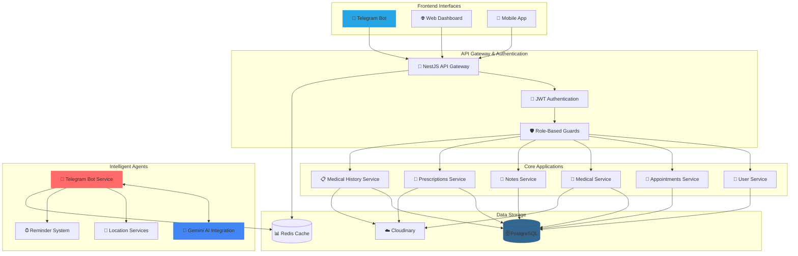
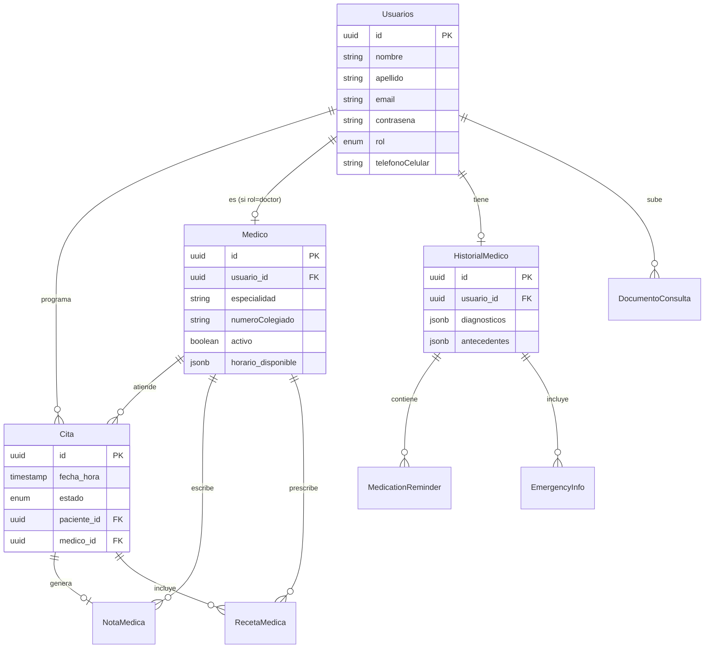

<div align="center">
  

  <br />

  <h1>🏥 Medical Appointments API</h1>

  <p><strong>Sistema Integral de Gestión Médica potenciado por Inteligencia Artificial y Telegram</strong></p>

  <br />

  <p>
    <a href="https://nestjs.com/"></a>
    <a href="https://www.typescriptlang.org/"></a>
    <a href="https://www.postgresql.org/"></a>
    <a href="https://graphql.org/"></a>
    <a href="https://core.telegram.org/bots/api"></a>
    <a href="https://ai.google.dev/"></a>
  </p>
  <p>
    
    
    
    
    
  </p>
</div>

<br />

---

## 📑 Tabla de Contenidos

- [⚡ Descripción General](#-descripción-general)
- [✨ Características](#-características-principales)
- [🏗️ Arquitectura del Sistema](#️-arquitectura-del-sistema)
- [🗃️ Modelo de Datos (ERD)](#️-modelo-de-datos-erd)
- [🛠️ Stack Tecnológico](#️-stack-tecnológico)
- [📁 Estructura del Proyecto](#-estructura-del-proyecto)
- [🚀 Instalación y Despliegue](#-instalación-y-despliegue)
- [🔐 Variables de Entorno](#-variables-de-entorno)
- [📖 Documentación de la API](#-documentación-de-la-api)
- [🧪 Calidad y Testing](#-calidad-y-testing)
- [🐳 Docker](#-docker)
- [⚙️ CI/CD](#️-cicd)
- [🗺️ Roadmap](#️-roadmap)
- [🤝 Contribuir](#-contribuir)
- [🔒 Seguridad](#-seguridad)
- [📄 Licencia](#-licencia)
- [📞 Autor y Contacto](#-autor-y-contacto)

---

## ⚡ Descripción General

**Medical Appointments API** es una solución de backend de vanguardia diseñada para transformar la administración sanitaria. Construida sobre la robustez de **NestJS**, esta plataforma no solo gestiona citas y pacientes, sino que integra un ecosistema completo de salud digital: historiales clínicos, notas y recetas médicas, recordatorios de medicación, información de emergencia, carga de documentos y asistencia médica automatizada 24/7 mediante un **Bot de Telegram con IA (Google Gemini)**.

> Diseñada con arquitectura modular, tipado estático con TypeScript, persistencia relacional con PostgreSQL + TypeORM y cache con Redis. Lista para escalar en clínicas, hospitales y consultorios modernos.

### ✨ Características Principales

| # | Característica | Descripción |
|---|----------------|-------------|
| 🤖 | **Asistente Médico IA** | Consultas preliminares, análisis de síntomas y recordatorios inteligentes powered by Google Gemini. |
| 📅 | **Gestión de Citas Avanzada** | Algoritmos de disponibilidad en tiempo real, estados (confirmada/cancelada/completada) y reprogramación. |
| 🔐 | **Seguridad de Grado Médico** | Roles granulares (admin/médico/paciente), JWT, guards basados en roles y encriptación de datos sensibles. |
| 📱 | **Omnicanalidad** | Acceso fluido desde Web, Móvil y Telegram. |
| 📝 | **Historial Clínico Digital** | Diagnósticos, antecedentes, alergias, medicación y resultados de laboratorio. |
| 💊 | **Recetas & Notas Médicas** | Generación de recetas y notas clínicas vinculadas a citas. |
| ⏰ | **Recordatorios de Medicación** | Sistema de recordatorios inteligentes para pacientes. |
| 🚨 | **Información de Emergencia** | Datos críticos accesibles rápidamente. |
| ☁️ | **Carga de Documentos** | Almacenamiento seguro de archivos en Cloudinary. |
| 📧 | **Notificaciones por Email** | Plantillas Handlebars + Nodemailer. |
| 📊 | **Paginación & Filtros** | Endpoints paginados para grandes volúmenes de datos. |
| 📖 | **Documentación Interactiva** | Swagger UI + GraphQL Playground. |
---

## 🏗️ Arquitectura del Sistema

Diseñado bajo una arquitectura modular y escalable, garantizando alto rendimiento, mantenibilidad y separación de responsabilidades (Clean Architecture + NestJS Modules).



### 🗃️ Modelo de Datos (ERD)

Estructura de base de datos relacional optimizada para integridad referencial y consultas complejas.


---

## 🛠️ Stack Tecnológico

| Capa | Tecnologías | Descripción |
| :--- | :--- | :--- |
| **Core** |   | Framework progresivo y tipado estático |
| **Data** |   | Persistencia robusta y ORM con migraciones |
| **Cache** |   | Gestión de sesiones y rate limiting |
| **IA & Bot** |   | Procesamiento de lenguaje natural y mensajería |
| **API** |    | Interfaces flexibles (REST + GraphQL) y docs |
| **Auth** |    | Autenticación y hashing de contraseñas |
| **Files** |  | Almacenamiento y transformación de imágenes |
| **Mail** |   | Envío de correos con plantillas |
| **Validación** |  | DTOs y validación declarativa |
| **Testing** |   | Unit & E2E testing |
| **DevOps** |   | Contenerización y CI/CD |

---

## 📁 Estructura del Proyecto

```text
medical-app/
├── .github/
│   └── workflows/
│       └── ci.yml              # Pipeline CI (build, migrations, tests)
├── src/
│   ├── @types/                 # Tipos globales (express, jsqr)
│   ├── auth/                   # Autenticación JWT, estrategias y guards
│   ├── citas/                  # Módulo de citas médicas
│   ├── cloudinary/             # Integración Cloudinary
│   ├── common/                 # Middleware, filtros, utilidades compartidas
│   ├── config/                 # Configuración TypeORM
│   ├── Entities/               # Entidades TypeORM (Usuario, Medico, Cita, ...)
│   ├── Gemini/                 # Integración Google Gemini AI
│   ├── Guard/                  # Guards personalizados
│   ├── historial-medico/       # Historial clínico del paciente
│   ├── Mail/                   # Servicio de correo (Nodemailer + Handlebars)
│   ├── medicos/                # Módulo de médicos y horarios
│   ├── migrations/             # Migraciones TypeORM
│   ├── nota_medica/            # Notas clínicas
│   ├── receta-medica/          # Recetas médicas
│   ├── telegram/               # Bot de Telegram (comandos, servicios, IA)
│   ├── telegram-historial-medico/
│   ├── templates/              # Plantillas Handlebars para email
│   ├── usuarios/               # Módulo de usuarios y roles
│   ├── app.module.ts           # Módulo raíz
│   ├── main.ts                 # Bootstrap + Swagger
│   └── schema.gql              # Schema GraphQL auto-generado
├── test/                       # Tests E2E
├── docker-compose.yml          # Orquestación (api, db, redis)
├── Dockerfile                  # Multi-stage build
├── .env.example                # Plantilla de variables de entorno
└── package.json
```
---

## 🚀 Instalación y Despliegue

### Prerrequisitos

- **Node.js** v18+
- **PostgreSQL** v14+
- **Redis** v6+ (opcional, el bot funciona sin Redis)
- **npm** v9+

### 1. Clonar el repositorio

```bash
git clone https://github.com/RubenDarioGuerreroNeira/medical-appointments-api.git
cd medical-appointments-api
```

### 2. Instalar dependencias

```bash
npm install
```

### 3. Configurar entorno

Crea un archivo `.env` basado en `.env.example`:

```bash
cp .env.example .env
```

### 4. Inicializar base de datos

```bash
npm run migration:run
```

### 5. Iniciar servidor

```bash
# Modo Desarrollo (hot-reload)
npm run start:dev

# Modo Debug
npm run start:debug

# Modo Producción
npm run build
npm run start:prod
```

El servidor queda disponible en `http://localhost:5500` (Swagger en `/api`).

---

## 🔐 Variables de Entorno

| Variable | Requerida | Descripción | Ejemplo |
|----------|:---------:|-------------|---------|
| `DB_HOST` | ✅ | Host de PostgreSQL | `localhost` |
| `DB_PORT` | ✅ | Puerto de PostgreSQL | `5432` |
| `DB_USERNAME` | ✅ | Usuario de BD | `postgres` |
| `DB_PASSWORD` | ✅ | Contraseña de BD | `password123` |
| `DB_NAME` | ✅ | Nombre de la BD | `medical_db` |
| `DATABASE_URL` | ⚪ | Connection string (alternativa) | `postgresql://...` |
| `JWT_SECRET` | ✅ | Secreto para firmar JWT | `super_secret_key` |
| `NODE_ENV` | ⚪ | Entorno de ejecución | `development` |
| `TELEGRAM_BOT_TOKEN` | ⚪ | Token del bot de Telegram | `123456:ABC...` |
| `GEMINI_API_KEY` | ⚪ | API Key de Google Gemini | `AIza...` |
| `CLOUDINARY_URL` | ⚪ | URL de Cloudinary | `cloudinary://...` |
| `MAIL_HOST` | ⚪ | Host SMTP | `smtp.gmail.com` |
| `MAIL_PORT` | ⚪ | Puerto SMTP | `587` |
| `MAIL_USER` | ⚪ | Usuario SMTP | `user@gmail.com` |
| `MAIL_PASS` | ⚪ | Contraseña SMTP | `app_password` |
| `MAIL_FROM` | ⚪ | Remitente por defecto | `no-reply@medical.app` |
| `REDIS_HOST` | ⚪ | Host de Redis | `localhost` |
| `REDIS_PORT` | ⚪ | Puerto de Redis | `6379` |

> ✅ Requerida · ⚪ Opcional (funcionalidad degradada si falta)
---

## 📖 Documentación de la API

### Swagger (REST)

Una vez iniciado el servidor, la documentación interactiva está disponible en:

```
http://localhost:5500/api
```

Incluye todos los endpoints REST con sus DTOs, validaciones y códigos de respuesta.

### GraphQL

El Playground de Apollo está disponible (solo en desarrollo) en:

```
http://localhost:5500/graphql
```

El schema se auto-genera en `src/schema.gql`.

### Módulos expuestos

| Módulo | Responsabilidad |
|--------|-----------------|
| `UsuariosModule` | Registro, autenticación, perfiles y roles |
| `MedicosModule` | Perfiles médicos, especialidades, horarios |
| `CitasModule` | Programación, estados y disponibilidad |
| `HistorialMedicoModule` | Historial clínico, diagnósticos, antecedentes |
| `NotaMedicaModule` | Notas clínicas vinculadas a citas |
| `RecetaMedicaModule` | Prescripciones y medicación |
| `TelegramModule` | Bot, comandos, IA y recordatorios |
| `CloudinaryModule` | Carga y gestión de archivos |
| `Mail` (MailerModule) | Envío de correos con plantillas |

---

## 🧪 Calidad y Testing

El proyecto mantiene altos estándares de calidad de código y cobertura de pruebas.

```bash
npm run test          # Unit Tests (Jest)
npm run test:watch    # Modo watch
npm run test:cov      # Reporte de cobertura
npm run test:e2e      # End-to-End Tests
npm run test:debug    # Debug con inspector
npm run lint          # ESLint + fix
npm run format        # Prettier
```

> **Coverage Goal:** > 90% en módulos críticos (auth, citas, historial).

### Convenciones de testing

- Tests unitarios junto al código (`*.spec.ts`).
- Tests E2E en `test/` con configuración `test/jest-e2e.json`.
- Mocks de repositorios TypeORM y servicios externos (Cloudinary, Mail, Gemini).
---

## 🐳 Docker

Levanta todo el stack (API, PostgreSQL, Redis) con un solo comando:

```bash
docker-compose up -d
```

Servicios expuestos:

| Servicio | Puerto | Descripción |
|----------|--------|-------------|
| `api` | `3000` | NestJS API (modo dev con hot-reload) |
| `db` | `5432` | PostgreSQL 14 |
| `redis` | `6379` | Redis (cache/sesiones) |

Para producción, construye la imagen multi-stage:

```bash
docker build -t medical-appointments-api .
docker run -p 5500:5500 --env-file .env medical-appointments-api
```

---

## ⚙️ CI/CD

Pipeline definido en `.github/workflows/ci.yml` (GitHub Actions):

1. **Checkout** del código.
2. **Setup Node.js 18**.
3. **Install** de dependencias.
4. **Build** TypeScript (`npm run build`).
5. **Create test database** (PostgreSQL 15 service).
6. **Run migrations** (`npm run migration:run`).
7. **Run tests** (`npm test`).

Se ejecuta en cada `push` y `pull_request` a `main`.

---

## 🗺️ Roadmap

- [x] Arquitectura modular NestJS + TypeORM
- [x] Autenticación JWT con roles (admin/médico/paciente)
- [x] Gestión de citas con estados
- [x] Historial clínico digital
- [x] Notas y recetas médicas
- [x] Bot de Telegram con IA (Gemini)
- [x] Recordatorios de medicación
- [x] Carga de documentos (Cloudinary)
- [x] Notificaciones por email
- [x] Docker + GitHub Actions CI
- [ ] Dashboard web (frontend)
- [ ] App móvil (React Native / Flutter)
- [ ] Telemedicina (videollamadas)
- [ ] Facturación y pagos
- [ ] Integración con laboratorios
- [ ] Multi-tenancy (varias clínicas)
- [ ] Métricas y observabilidad (Prometheus/Grafana)
---

## 🤝 Contribuir

¡Las contribuciones son bienvenidas! Para contribuir:

1. Haz fork del repositorio.
2. Crea una rama para tu feature: `git checkout -b feature/mi-feature`.
3. Sigue las convenciones de código (ESLint + Prettier).
4. Escribe/actualiza tests para tus cambios.
5. Asegúrate de que `npm run lint`, `npm run build` y `npm test` pasen.
6. Abre un Pull Request describiendo el cambio.

### Convenciones de commits

Se recomienda [Conventional Commits](https://www.conventionalcommits.org/):

```
feat: nueva funcionalidad
fix: corrección de bug
docs: cambios en documentación
refactor: refactorización sin cambio de comportamiento
test: añadir o corregir tests
chore: tareas de mantenimiento
```

---

## 🔒 Seguridad

- Las contraseñas se almacenan hasheadas con **bcrypt**.
- Autenticación basada en **JWT** con guards por rol.
- Validación de entrada con `class-validator` en todos los DTOs.
- Variables sensibles gestionadas por `.env` (nunca commitear secretos).
- CORS habilitado; configurar orígenes permitidos en producción.
- En producción, usar `synchronize: false` y migraciones; SSL para Postgres.

Si descubres una vulnerabilidad, por favor repórtala de forma privada al autor antes de hacerla pública.

---

## 📄 Licencia

Este proyecto es de uso privado (`UNLICENSED`). Todos los derechos reservados.

---

## 📞 Autor y Contacto

<div align="center">
  
  <br />
  <strong>Rubén D. Guerrero N.</strong>
  <br />
  <p>Full Stack Developer & AI Integration Specialist</p>

  <a href="mailto:rudargeneira@gmail.com">
    
  </a>
  <a href="https://t.me/Rubedev">
    
  </a>
  <a href="https://linkedin.com/in/rubendguerrero">
    
  </a>
  <a href="https://github.com/RubenDarioGuerreroNeira">
    
  </a>
</div>

---

<p align="center">
  Made with ❤️ using NestJS and AI
</p>